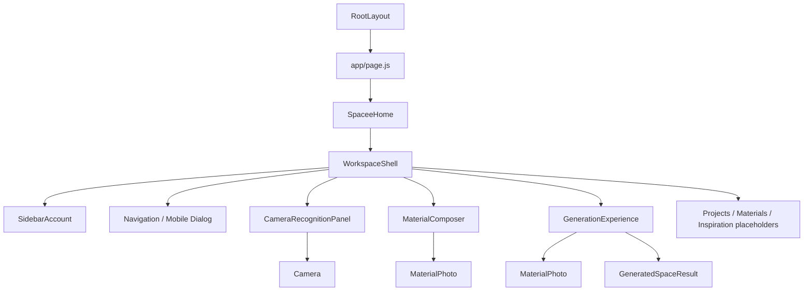
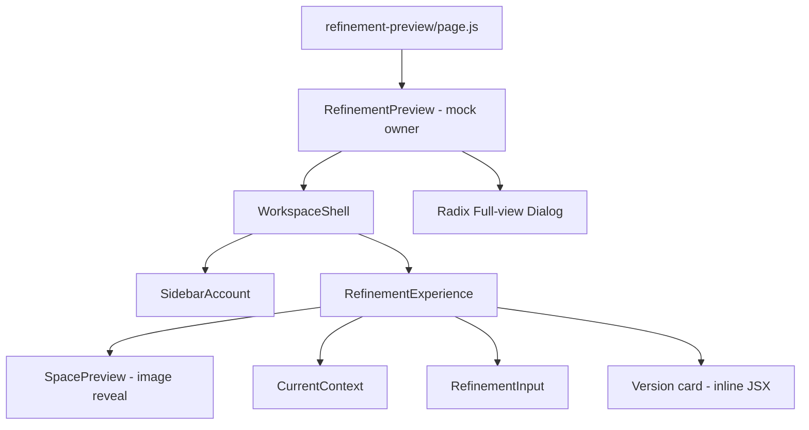
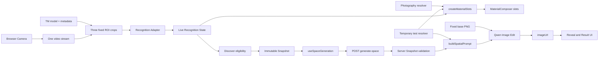

# Spaceee — Current Frontend Architecture Assessment

调查日期：2026-10-09（Asia/Singapore）。对象：`D:/dowload/spaceee1` 当前工作目录，**包含尚未提交的改动**，不是仅以 Git HEAD 为准。

## 1. 范围、方法与结论

本次仅调查，并新增这份文档；没有执行上一轮被中断的 Material Architecture 第 2 步，没有修改业务代码、安装依赖、调用付费生成接口或重构。

证据来自源码、导入关系搜索、公开模型 metadata、现有单元测试及 lint。下文：

- **事实**：源码或本次命令输出能够直接确认。
- **评价/风险**：根据事实推导的维护或扩展问题，不代表已复现故障。
- **未验证**：本次没有实机相机、真实生成、跨设备或部署测试，不能据此保证运行效果。

**核心结论：当前是“Camera 驱动的三位置生成 Prototype”，并非“Material Library 和 Camera 共用 Selected Materials”的产品架构。** 当前主链路已经有真实实现：相机 → 三 ROI 分类 → Position Recognition → 冻结 Snapshot → 服务端重建 Prompt → Qwen 图像编辑 → 展示结果。但五材料 Registry 尚未接入这条链路；Library、保存、搜索、拖拽和真实 refinement 都未接入。

依据：[SpaceeHome.jsx](D:/dowload/spaceee1/components/SpaceeHome.jsx:14) 14–42 行；[materialViewModel.js](D:/dowload/spaceee1/features/materials/materialViewModel.js:1)；[promptGeneration.js](D:/dowload/spaceee1/features/exploration/promptGeneration.js:61)；[RefinementPreview.jsx](D:/dowload/spaceee1/app/refinement-preview/RefinementPreview.jsx:9)。

## 2. 当前目录与主要文件职责

以下是现有目录的职责索引，不是建议的新文件夹结构。省略 `node_modules`、`.next`、`.git` 和逐个静态图标。

```text
spaceee1/
├── app/                         Next.js App Router：页面入口、全局样式、API
│   ├── layout.js                全局 HTML/body、metadata、Geist 字体
│   ├── page.js                  首页字体配置，渲染 SpaceeHome
│   ├── globals.css              Tailwind 入口/少量主题 token/旧 Prototype 样式/Camera 基础样式
│   ├── recognition-test/        真实三 ROI、Snapshot、Prompt、API 的技术测试页
│   ├── spacee-prototype/        Phase 4A mock Position/Snapshot 验证页
│   ├── generation-preview/     生成/结果布局预览，内部也保留真实 API 请求逻辑
│   ├── refinement-preview/     独立 mock refinement 页面及容器
│   └── api/
│       ├── generate-space/route.js   请求解析、验证编排、生成、安全错误响应
│       └── download-space/route.js   生成图片下载代理入口
├── components/
│   ├── SpaceeHome.jsx           首页业务编排和页面内阶段切换
│   ├── Camera.jsx               浏览器 MediaStream 生命周期、video、权限状态
│   ├── MaterialPhoto.jsx        产品照片与未提供照片 fallback
│   ├── GenerationExperience.jsx 等待阶段、真实图片加载和模糊→清晰、结果切换
│   ├── GeneratedSpaceResult.jsx 结果说明、重新生成、Full view、下载请求
│   ├── workspace/
│   │   ├── WorkspaceShell.jsx   Sidebar、桌面折叠、移动端 Radix drawer、布局
│   │   ├── SidebarAccount.jsx   Guest 账号占位及开发工具入口
│   │   ├── CameraRecognitionPanel.jsx 相机区域、ROI 叠层、Restart
│   │   └── MaterialComposer.jsx 三个显示槽位、文字草稿、Clear/Generate callbacks
│   └── refinement/
│       ├── RefinementExperience.jsx 结果预览与对话区域，内部 SpacePreview 动画
│       ├── CurrentContext.jsx   props 驱动的材料和初始请求展示
│       ├── RefinementInput.jsx  输入/附件/提交 callbacks；没有 API 调用
│       └── RefinementIcon.jsx   refinement 图标
├── features/
│   ├── recognition/
│   │   ├── useLiveRecognition.js 首页识别 hook：模型、循环、Live State
│   │   ├── teachableMachineAdapter.js 分类输出→位置记录，阈值判断与 class slug
│   │   ├── recognitionConfig.js .75 阈值、首页 2500ms 重查间隔
│   │   ├── recognitionRegions.js 固定 ROI、原生视频像素/显示区域换算
│   │   ├── positionRecognition.js Position 规则、Discover eligibility、Snapshot
│   │   ├── mockPositionRecognition.js mock 场景
│   │   ├── recognitionHandler.js 旧 category/confidence 排序型识别转换
│   │   └── materialMapper.js    旧 Natural/Artificial/Cultural 分类定义
│   ├── materials/
│   │   ├── temporaryMaterialInformation.js 三种测试材料名称和 unknown 属性
│   │   ├── materialPresentation.js 测试材料照片地址（当前均为 null）
│   │   ├── materialViewModel.js 测试材料信息+照片→UI slots
│   │   └── mockMaterialCatalog.js Phase 4A mock A/B/C
│   └── exploration/
│       ├── useSpaceGeneration.js 首页 Snapshot-only 请求、状态、重试、AbortController
│       ├── generationRequest.js 服务端 Snapshot 验证与 Prompt 编排
│       ├── promptGeneration.js 现有 buildSpatialPrompt，另有旧 category prompt 函数
│       ├── spatialTemplate.js   固定空间底稿尺寸和结构保留指令
│       ├── materialSelection.js 旧最多三个/按 ID 去重选择工具
│       ├── explorationState.js  旧 capture-specific Material Object factory
│       └── explorationSession.js 旧 selecting/ready/completed session helpers
├── lib/
│   ├── materials/materials.js   新五材料 Registry 与查询函数；尚未接入业务
│   ├── teachableMachine.js      浏览器模型加载、单区和多 ROI 预测底层
│   ├── qwenImage.js             server-only Qwen 调用、超时、响应抽取
│   ├── qwenImageRequest.js      纯函数构建 image-edit 请求
│   ├── spaceBaseImage.js        server-only 底稿文件验证与 base64 输入
│   └── spaceImageDownload.js    下载 URL 校验、大小限制、下载响应
├── public/
│   ├── images/space-base.png    真实生成用固定底稿，不是生成结果
│   ├── materials/README.md      产品 cutout 接入说明；目前没有这些产品照片
│   ├── figma/                  设计导出的 SVG，包括 workspace 图标
│   └── prototypes/refinement/  mock 房间与 oak/cork/acrylic 图片
├── **/*.test.mjs               Node 原生测试，分布在 features/lib
├── package.json / package-lock.json 依赖、版本和命令
├── next.config.mjs             固定底稿加入 API 服务端文件追踪
├── postcss.config.mjs          Tailwind v4 PostCSS
├── jsconfig.json               @/* → 仓库根路径；没有业务类型定义
├── eslint.config.mjs           ESLint 配置
├── .env.example                环境变量名称说明；不含凭据
├── README.md                   仍是 create-next-app 默认使用说明
├── AGENTS.md / CLAUDE.md        代理工作规则，不是运行时产品架构
└── docs/architecture/          本次现状报告
```

目录与职责依据：各文件的实际导入/导出及调用。特别注意“canonical”“Phase extension point”等历史注释不能证明某个模块仍是主入口。当前主入口直接见 [app/page.js](D:/dowload/spaceee1/app/page.js:1)、[SpaceeHome.jsx](D:/dowload/spaceee1/components/SpaceeHome.jsx:3)，依赖/命令见 [package.json](D:/dowload/spaceee1/package.json:6)。根目录还有一个未跟踪的参考 JPG；没有发现运行时代码引用它，不应当作产品数据源。

## 3. 页面与 Component Tree

### 3.1 页面边界

| 路由 | 当前入口/职责 | 真实数据与界限 |
|---|---|---|
| `/` | `app/page.js` → `SpaceeHome` | 真相机、真识别、真生成接口；主页与结果是同一页面内状态切换 |
| `/recognition-test` | `app/recognition-test/page.js` | 真 TM；显式 Discover → Generate Prompt → Generate Space；不是纯静态预览 |
| `/spacee-prototype` | `app/spacee-prototype/page.js` | mock 位置场景 → eligibility → Snapshot；无真实摄像头 |
| `/generation-preview` | `GenerationPreview` | 初始 layoutPreview；内部 `generate()` 能调用真实 API，错误重试等路径可到达，不应视为绝不会产生费用 |
| `/refinement-preview` | `RefinementPreview` | oak/cork/acrylic、房间、Version 01、时间均 mock；提交只更新 notice |

依据：[recognition-test/page.js](D:/dowload/spaceee1/app/recognition-test/page.js:178)、[spacee-prototype/page.js](D:/dowload/spaceee1/app/spacee-prototype/page.js:18)、[GenerationPreview.jsx](D:/dowload/spaceee1/app/generation-preview/GenerationPreview.jsx:12) 12–40 行、[RefinementPreview.jsx](D:/dowload/spaceee1/app/refinement-preview/RefinementPreview.jsx:9) 9–25 行。

### 3.2 首页组件树（实线表示渲染关系，不表示文件夹层级）



`SpaceeHome` 的 children 被 `WorkspaceShell` 放入 main。Camera/Composer 在非首页或生成时用 `hidden` 隐藏，没有因此卸载；`GenerationExperience` 仅在 generation 非 idle 时挂载；真实结果在图片加载及动画结束后由该组件替换输出。依据：[SpaceeHome.jsx](D:/dowload/spaceee1/components/SpaceeHome.jsx:62) 62–76 行、[WorkspaceShell.jsx](D:/dowload/spaceee1/components/workspace/WorkspaceShell.jsx:36) 36–58 行、[GenerationExperience.jsx](D:/dowload/spaceee1/components/GenerationExperience.jsx:24) 24–50 行。

### 3.3 Refinement 分支（尚未和首页生成分支连接）



依据：[RefinementExperience.jsx](D:/dowload/spaceee1/components/refinement/RefinementExperience.jsx:29) 29–42 行及 [RefinementPreview.jsx](D:/dowload/spaceee1/app/refinement-preview/RefinementPreview.jsx:20)。`CurrentContext` 不识别材料、`RefinementInput` 不调用生成 API；这一分支已经使用 props/callback 分离数据与 UI。

### 3.4 职责偏重的位置

| 组件 | 已确认职责 | 评价 |
|---|---|---|
| `SpaceeHome` | workspace section、相机启停/重启、activePosition、草稿、eligibility、Snapshot 触发、generation 切换 | 当前是合理的编排入口，但未来加入 Library source arbitration 后会成为扩展热点，不应把现状简单称为所有逻辑都塞在一个组件 |
| `RecognitionTestPage` | 模型/相机/循环、ROI 布局、raw probabilities、Snapshot、Prompt preview、请求及整页 JSX | 最明显的大型复合页；451 行，且重复主流程逻辑 |
| `GeneratedSpaceResult` | 展示、名称解析、下载 fetch/blob、dialog 控制、下载错误 | 网络副作用和展示耦合；与 refinement 的 callback 下载模式不同 |
| `GenerationExperience` | 图片 readiness、失败/重试、时间文案、材料解析、motion、结果分派 | 是多个 UI 状态的协调器，材料解析也直接绑临时 resolver |

依据：[SpaceeHome.jsx](D:/dowload/spaceee1/components/SpaceeHome.jsx:20)、[recognition-test/page.js](D:/dowload/spaceee1/app/recognition-test/page.js:63)、[GeneratedSpaceResult.jsx](D:/dowload/spaceee1/components/GeneratedSpaceResult.jsx:15) 15–53 行、[GenerationExperience.jsx](D:/dowload/spaceee1/components/GenerationExperience.jsx:16) 16–84 行。

## 4. 当前 Data Flow：哪些真正相连



该图依据：Camera 46–73 行；TM loop 109–177 行；useLiveRecognition 40–49 行；SpaceeHome 31–42 行；useSpaceGeneration 13–26 行；API 40–55 行；Prompt Builder 61–83 行；qwenImageRequest 17–26 行。

**明确不存在的连接：** Material Library → Selected slots；Registry → 首页 Material View Model；Registry `materialPrompt` → 当前 Prompt Builder；真实 Result → refinement-preview。不能画实线把这些目标当作已实现。证明是主页实际导入/调用链、Materials placeholder 和 mock refinement 入口，详见第 3、5、6 节。

### 4.1 Library

Sidebar 的 Materials 按钮只 `onNavigate('materials')`，父组件切换 `activeSection` 并显示一段 placeholder。没有已保存材料数据、搜索输入、选择事件、拖拽 handler 或持久化读取。

依据：[WorkspaceShell.jsx](D:/dowload/spaceee1/components/workspace/WorkspaceShell.jsx:10) 10–32 行；[SpaceeHome.jsx](D:/dowload/spaceee1/components/SpaceeHome.jsx:14) 14–18、76 行。本次对 `app/components/features/lib` 搜索 `onDrop`、`draggable`、`localStorage`、`sessionStorage`，没有发现产品实现；仅有导航和静态资源不能证明 Library 完成。

### 4.2 Camera → Selected Materials

目前所谓 selected materials 是**live positions 的派生显示**，不是独立选择状态。`SpaceeHome` 从 `liveState.positions` 提取已 recognized 的 ID，调用 `createMaterialSlots()` 得到 `{position, material}`；material 由临时 resolver 与照片 resolver 拼成。

点击槽位只设置 `activePosition` 并启动 Camera，没有把某个 Registry material 放入槽位、确认冻结某一槽位、删除某一材料或拖放替换的逻辑。识别变化会自然覆盖显示；去重属于 eligibility，不属于 recognition。

依据：[SpaceeHome.jsx](D:/dowload/spaceee1/components/SpaceeHome.jsx:34) 34–36、71 行；[materialViewModel.js](D:/dowload/spaceee1/features/materials/materialViewModel.js:5)；[MaterialComposer.jsx](D:/dowload/spaceee1/components/workspace/MaterialComposer.jsx:9) 9–24 行；[positionRecognition.js](D:/dowload/spaceee1/features/recognition/positionRecognition.js:50) 50–79 行。

**未来扩展风险（推导）：** 当前 Generate 条件硬依赖 `cameraStatus === 'active'` 和 recognition running。即使将来从 Library 放满三个槽位，不启 Camera 也无法生成；目前尚无“Library 与 Camera 谁能更新哪个槽位”的规则。

### 4.3 Live / Snapshot / Request 三种对象

```js
// useLiveRecognition 中的一项；不是 Material Profile
{ position: 1, priority: 1, materialId: 'coke-can',
  className: 'coke can', confidence: 0.92,
  status: 'recognized', observedAt: '...' }

// createMaterialSlots 的 UI 项；不带识别证据
{ position: 1, material: {
  id: 'coke-can', name: 'Coke Can', category: null,
  properties: { material: 'unknown', texture: 'unknown',
                color: 'unknown', form: 'unknown' }, imageSrc: null
} }

// 当前 POST body：传 Snapshot，不传 UI material 对象/名称/最终 prompt
{ snapshot: { sessionId: '...', createdAt: '...', status: 'captured',
  materials: [
    { position: 1, priority: 1, materialId: 'coke-can', confidence: 0.92 },
    { position: 2, priority: 2, materialId: 'blackcan', confidence: 0.89 },
    { position: 3, priority: 3, materialId: 'tissue', confidence: 0.95 }
  ]
} }
```

依据：[teachableMachineAdapter.js](D:/dowload/spaceee1/features/recognition/teachableMachineAdapter.js:38)、[temporaryMaterialInformation.js](D:/dowload/spaceee1/features/materials/temporaryMaterialInformation.js:34)、[positionRecognition.js](D:/dowload/spaceee1/features/recognition/positionRecognition.js:93)、[useSpaceGeneration.js](D:/dowload/spaceee1/features/exploration/useSpaceGeneration.js:20)。示例数字仅演示结构，不是本次摄像头测量。

Snapshot 的对象、materials 数组及各项冻结；没有名称、Material Profile、Registry 版本、属性副本或初始文字。它保存观察时的 ID/position/priority/confidence。主 hook 的 retry 使用原 Snapshot，不取未来 Live State。

主页没有独立 DISCOVER 按钮：Generate My Space 内部立即 `createExplorationSnapshot(liveState)` 再发请求；技术测试页则把 Discover、Generate Prompt、Generate Space 拆成显式步骤。依据：[SpaceeHome.jsx](D:/dowload/spaceee1/components/SpaceeHome.jsx:40)、[recognition-test/page.js](D:/dowload/spaceee1/app/recognition-test/page.js:178)。

### 4.4 文字与 generation/result

`description` 只作为 MaterialComposer requirement；UI 明示 “Draft note only”。Snapshot/request 没有它，因此当前输入文字不会影响生成。生成返回后 hook 只保留 imageUrl、snapshot、status；API 返回的 requestId/sessionId/prompt 没有存入首页 generation state。

结果组件支持 `generation.interpretation`，但首页 hook/API 不产生这段解释。默认标题与按材料名称拼接的说明属于前端 fallback，**不是另一轮 AI interpretation 的输出**。

依据：[MaterialComposer.jsx](D:/dowload/spaceee1/components/workspace/MaterialComposer.jsx:24)、[useSpaceGeneration.js](D:/dowload/spaceee1/features/exploration/useSpaceGeneration.js:26)、[generate-space/route.js](D:/dowload/spaceee1/app/api/generate-space/route.js:51)、[GeneratedSpaceResult.jsx](D:/dowload/spaceee1/components/GeneratedSpaceResult.jsx:21)。

## 5. React State、Props、Hooks 与共享范围

| Owner | State / ref | 共享方式与生命周期 |
|---|---|---|
| `useLiveRecognition` | liveState、status、error；loop/video/mounted/version refs | 首页持有 hook 返回值，传 callbacks/ref 给 Camera；卸载停止循环 |
| `SpaceeHome` | cameraStarted/key/status、activePosition/section、description | 通过 props 给 Shell/CameraPanel/Composer；页面内导航，不是 route state |
| `useSpaceGeneration` | generation；requestRef、snapshotRef | 原 Snapshot 重试；防并发；卸载 abort 浏览器请求 |
| `Camera` | status/error；stream/video/callback refs | 本地拥有 stream；onStatusChange 同步父状态；卸载 stop tracks |
| `WorkspaceShell` | expanded/mobileOpen | 仅布局 UI 本地状态；没有跨页面存储 |
| `GenerationExperience` | phase、loaded/revealed/failed URL、attempt | 仅 reveal/等待状态；不是实际服务端进度 |
| `GeneratedSpaceResult` | downloading/error；dialog/download refs | 组件内部请求下载接口 |
| `RefinementPreview` | mock materials、requirement、notice、fullView、activeSection | props 和 callbacks 下传；与首页 state 完全独立 |

依据：对应文件的 `useState`/`useRef` 声明，分别见 [useLiveRecognition.js](D:/dowload/spaceee1/features/recognition/useLiveRecognition.js:16)、[SpaceeHome.jsx](D:/dowload/spaceee1/components/SpaceeHome.jsx:20)、[useSpaceGeneration.js](D:/dowload/spaceee1/features/exploration/useSpaceGeneration.js:6)、[WorkspaceShell.jsx](D:/dowload/spaceee1/components/workspace/WorkspaceShell.jsx:17)、[RefinementPreview.jsx](D:/dowload/spaceee1/app/refinement-preview/RefinementPreview.jsx:12)。

事实：没有产品级 Context provider、Redux、Zustand、query cache 或其他共享 state library；RootLayout 只包 HTML/body。Radix 自身的内部 Context 不等于业务共享状态。材料、generation、Sidebar 展开状态都没有应用级持久化；刷新/跨路由没有现成恢复机制。依据：[layout.js](D:/dowload/spaceee1/app/layout.js:19)、[package.json](D:/dowload/spaceee1/package.json:13) 及源码搜索。

评价：当前小型 Prototype 使用 hooks + props 并不构成缺陷，也没有证据需要新增 state library。扩展风险在于业务 state owner 尚未覆盖两种材料输入来源，而非缺少某个第三方库。

## 6. Material Registry 与材料身份

### 6.1 Registry 当前事实

[lib/materials/materials.js](D:/dowload/spaceee1/lib/materials/materials.js:9) 定义冻结记录及查询；字段是：

`id / name / dataStatus / visualProperties / texture / color / lighting / recommendedUsage / avoid / materialPrompt`。

五个 ID：`japanese-igusa`、`jute`、`split-marble-gray`、`oak-knotty-e190`、`cement-02-ea6652k`。

所有记录 `dataStatus = needs-sample-verification`；visualProperties 内 surface/pattern/finish/opacity 均 null，texture/color/lighting null，recommendedUsage/avoid 空数组；materialPrompt 仅 `Material: <name>.`。不包含上轮提议的 `japaneseName / category / textureProperties / colorProperties / lightingBehavior`。未知 ID 查询返回 null，没有测试材料 alias。

**尚未业务接入。** 搜索 getMaterialById/getMaterialPrompt 及 registry 导入，除定义和 Registry 单元测试外，没有首页、识别或 API 消费者。不能因为文件存在就说生成已使用 Material Prompts。依据：[materials.js](D:/dowload/spaceee1/lib/materials/materials.js:33) 33–50 行；[materialViewModel.js](D:/dowload/spaceee1/features/materials/materialViewModel.js:1)；[promptGeneration.js](D:/dowload/spaceee1/features/exploration/promptGeneration.js:1)。

### 6.2 当前并存的材料表示

| 数据源 | ID/属性形式 | 实际使用位置 |
|---|---|---|
| 新 Registry | 稳定真实产品 slug、详细属性字段框架 | 当前仅测试 |
| 临时 resolver | `coke-can / blackcan / tissue`、name/category/properties | 首页 slots、生成等待/结果、服务端 Prompt |
| 摄影 resolver | 测试 ID → imageSrc（null） | MaterialPhoto、View Model、生成阶段 |
| mock catalog | `mock-material-a/b/c` | `/spacee-prototype` |
| refinement fixtures | `oak / cork / acrylic`，图片字段叫 `image` | `/refinement-preview` |
| 旧 Material factory | `material_${Date.now()}`，category/confidence/capturedAt | 当前生产页面未发现调用 |

依据：[temporaryMaterialInformation.js](D:/dowload/spaceee1/features/materials/temporaryMaterialInformation.js:14)、[materialPresentation.js](D:/dowload/spaceee1/features/materials/materialPresentation.js:4)、[mockMaterialCatalog.js](D:/dowload/spaceee1/features/materials/mockMaterialCatalog.js:6)、[RefinementPreview.jsx](D:/dowload/spaceee1/app/refinement-preview/RefinementPreview.jsx:9)、[explorationState.js](D:/dowload/spaceee1/features/exploration/explorationState.js:56)。

### 6.3 Unknown 与 unsupported 并未统一

Recognition 的 Unknown 由最高概率低于 .75 决定，materialId 为 null，保留 className/confidence；首页把这项 material 显示为 null。**“高置信度但 Registry 未收录”当前不算 Unknown**：eligibility 只检查 status、非空 ID、三个位置与唯一性，不检查 Registry；临时 resolver 会把任意非空 ID 转成显示名称，所有属性 unknown；API 只检查 ID 格式，不做 Registry 白名单验证。

因此“recognized”目前代表分类器输出通过阈值，不代表 Material Profile 已验证/产品受支持。当前测试流程不会因五材料 Registry 不匹配而崩溃，但也没有显式 unsupported 类型。依据：[adapter](D:/dowload/spaceee1/features/recognition/teachableMachineAdapter.js:35)、[positionRecognition](D:/dowload/spaceee1/features/recognition/positionRecognition.js:50)、[temporary resolver](D:/dowload/spaceee1/features/materials/temporaryMaterialInformation.js:26)、[generationRequest](D:/dowload/spaceee1/features/exploration/generationRequest.js:51)。

## 7. Teachable Machine 与 Camera 的实际接入

**已接入，不是“未来才开始接 TM”。** 未来待做的是五种真实材料模型，而非从零建立 Camera→TM 连接。

1. Camera 浏览器调用 `getUserMedia({video:{facingMode:'environment'},audio:false})`，单个 video 播放，准备完成通过 callback 上报，卸载停止 tracks。[Camera.jsx](D:/dowload/spaceee1/components/Camera.jsx:38) 38–99 行。
2. `@teachablemachine/image` 懒加载，model URL 来自 `NEXT_PUBLIC_TEACHABLE_MODEL_URL`，加载 model.json/metadata.json。[teachableMachine.js](D:/dowload/spaceee1/lib/teachableMachine.js:20) 20–57 行。
3. 三个 ROI 用 0–1 坐标配置，按 videoWidth/videoHeight 转原生像素；显示用 contain rectangle 与 ResizeObserver 对齐。当前不镜像，crop canvas 224×224。[recognitionRegions.js](D:/dowload/spaceee1/features/recognition/recognitionRegions.js:8)、[CameraRecognitionPanel.jsx](D:/dowload/spaceee1/components/workspace/CameraRecognitionPanel.jsx:11)。
4. 每轮同一个模型顺序预测三个 canvas，整组完成后一次回调。首页间隔 2500ms，技术页 150ms；不是三个独立摄像头，也不是三路并行模型。[teachableMachine.js](D:/dowload/spaceee1/lib/teachableMachine.js:109)、[recognitionConfig.js](D:/dowload/spaceee1/features/recognition/recognitionConfig.js:2)、[recognition-test/page.js](D:/dowload/spaceee1/app/recognition-test/page.js:128)。
5. priority 固定等于 position；仅在各 ROI 内找最高概率 class。不会用 confidence 决定三个位置优先级。[teachableMachineAdapter.js](D:/dowload/spaceee1/features/recognition/teachableMachineAdapter.js:28)。

本次只读请求当前 public model URL 的 metadata，返回 **`coke can`、`blackcan`、`tissue`**；adapter 转换为 `coke-can / blackcan / tissue`。这是本次外部读取结果，未来 URL 内容可变化；没有下载验证完整权重或拍摄实物。五种真实材料不在这次 metadata 中。

**风险/限制，不是已复现事故：**

- 每个 crop 在前一个 `await model.predict` 后才 drawImage 当前 live video；虽然整组一起发布，但没有先冻结同一帧。快速移动时三位置可能来自不同时间点。依据 TM 154–170 行。
- 没有空背景专门类别、连续多轮稳定判断或自动定位物体。低阈值判断不能保证空位必定 Unknown；无关物也可能被高置信度误分。依据 adapter 35–46 行、metadata 三标签、固定 ROI 配置。
- hidden 不卸载 Camera，生成/Sidebar placeholder 阶段仍可继续识别，属于当前代码的明确行为；有资源/隐私提示需求，不能误以为 Camera 已关闭。依据 SpaceeHome 64–75 行。
- ROI 的 width/height 同为 .3 是“归一化尺寸相同”，原生非方形视频里并不是方形像素 crop，再缩为 224×224 可能产生形变；准确率需按安装条件验证。依据 ROI 9–11 行与原生坐标换算 59–62 行。

## 8. API、AI Generation、环境变量与外部依赖

### 8.1 Generate API

`POST /api/generate-space` → request.json → prepareGenerationRequest → validateGenerationSnapshot → buildSpatialPrompt → generateQwenImage。验证恰好三个、positions/priorities=1/2/3、priority=position、ID 格式/长度/唯一性、captured 状态；复制认可字段，忽略客户端额外 prompt/profile 数据。生成失败返回分类后的安全错误。

依据：[route.js](D:/dowload/spaceee1/app/api/generate-space/route.js:30)、[generationRequest.js](D:/dowload/spaceee1/features/exploration/generationRequest.js:22)。优点：最终 Prompt 由服务端重建，UI 无法靠传 prompt 字段直接覆盖；但“ID 格式合法”不等于“Registry 支持”。

现有 Builder 从临时 resolver 的 `name/category/properties` 生成 Prompt，**不读取 getMaterialPrompt**。服务端 Qwen 从固定底稿生成图像编辑请求，不是只传文本的 image-plus。当前源码默认：

- 模型 `qwen-image-edit-plus`，允许有限 image-edit family override。
- 输出 `1280*960`；底稿 1448×1086，4:3。
- `prompt_extend: false`、`watermark: false`、`n:1`。
- Provider fetch timeout 120 秒。

依据：[qwenImageRequest.js](D:/dowload/spaceee1/lib/qwenImageRequest.js:3)、[spatialTemplate.js](D:/dowload/spaceee1/features/exploration/spatialTemplate.js:4)、[qwenImage.js](D:/dowload/spaceee1/lib/qwenImage.js:23)。这些是源码默认值；没有输出或披露本地 key/override 值，也没有声称本次真实生成使用哪个 override。早期讨论中的 image-plus/1664×928/prompt expansion enabled 不是当前源码配置。

API 成功响应 `{imageUrl, requestId, sessionId, prompt}`；没有 key/完整 Provider payload。[route.js](D:/dowload/spaceee1/app/api/generate-space/route.js:51)。固定底稿服务端读取/验证 PNG，并通过 next.config file tracing 纳入生成 API 部署文件。[spaceBaseImage.js](D:/dowload/spaceee1/lib/spaceBaseImage.js:7)、[next.config.mjs](D:/dowload/spaceee1/next.config.mjs:4)。

### 8.2 Download API

结果组件发送 imageUrl 到 `/api/download-space`。服务端只接受指定 Aliyun OSS HTTPS host pattern，拒绝 credentials、port、redirect；限制 image MIME、20MiB，超时 30 秒；以 attachment 返回，无持久化。依据：[GeneratedSpaceResult.jsx](D:/dowload/spaceee1/components/GeneratedSpaceResult.jsx:28)、[spaceImageDownload.js](D:/dowload/spaceee1/lib/spaceImageDownload.js:8)。

评价：已有 SSRF 防御边界和大小限制；Provider URL host 改动会影响下载，这是显式第三方耦合，不是通用任意图像下载。

### 8.3 配置与依赖边界

| 项目 | 使用层 | 已确认作用 |
|---|---|---|
| `NEXT_PUBLIC_TEACHABLE_MODEL_URL` | browser | 公开模型地址；客户端 bundle 配置，不是秘密 key |
| `QWEN_API_KEY` | server-only `qwenImage.js` | Authorization；没有 NEXT_PUBLIC 前缀 |
| `QWEN_API_URL` | server | 可选 Provider endpoint override |
| `QWEN_IMAGE_EDIT_MODEL` | server | 可选 image-edit model override |
| Next 16.3.7 / React 19.2.8 | app | App Router、页面、API、Client Components |
| `@teachablemachine/image` | browser | 本地推断，模型文件网络加载 |
| `motion` | browser | 真图返回后的 reveal、mock refine reveal |
| Radix Dialog/Popover | browser | Sidebar drawer、Guest popover、mock full view |
| `react-textarea-autosize` | browser | 首页/refinement 输入高度 |
| Tailwind v4 + CSS Modules | styling | utilities/主题 token + 组件样式 |
| `next/font/google` | 页面/布局 | DM Serif Text、Inter、Geist 字体配置 |

依据：[.env.example](D:/dowload/spaceee1/.env.example:1)、[qwenImage.js](D:/dowload/spaceee1/lib/qwenImage.js:1)、[package.json](D:/dowload/spaceee1/package.json:13)、[app/page.js](D:/dowload/spaceee1/app/page.js:1)、[globals.css](D:/dowload/spaceee1/app/globals.css:1)、[postcss.config.mjs](D:/dowload/spaceee1/postcss.config.mjs:1)。当前没有 Supabase SDK、数据库调用、登录 session、React Flow 或材料拖拽库的使用证据。

相机 frames 没有沿 generation API 发送；Qwen 输入图片是服务端固定底稿，二者不是同一图像流。推断在浏览器，但模型资源仍需网络加载。`server-only` 边界已用于 Qwen/底稿，不应把“浏览器识别”理解成完全离线产品。

## 9. 重复逻辑、高耦合与状态风险

| 已确认事实 | 维护/扩展风险（推导） | 代码依据 |
|---|---|---|
| 首页 hook、recognition-test、generation-preview 各有请求和状态实现 | loading/error/并发/取消处理可能漂移 | useSpaceGeneration 13–29；recognition-test 191–228；GenerationPreview 23–37 |
| 测试页有自己的模型/loop/state，而首页使用 hook | 频率、错误恢复和 Snapshot 使用可不一致；当前已有 150ms/2500ms 差别 | recognition-test 108–176；useLiveRecognition 30–64 |
| 临时 resolver 在 View Model、MaterialPhoto、GenerationExperience、GeneratedSpaceResult、Builder 重复消费 | 新 Registry 即使补全也不能自动影响这些位置；一次迁移要核对多个消费者 | materialViewModel 1–10；MaterialPhoto 6–13；GenerationExperience 9–68；GeneratedSpaceResult 6–23；Builder 2、63 |
| 旧 recognitionHandler 按概率排序生成 priority；新 adapter 按 position priority | 旧函数若被重新接入会破坏产品规则；当前主入口没有用旧函数，所以不是当前链路 bug | recognitionHandler 39–46；adapter 38–41；首页/识别 hook 导入链 |
| 旧 factory 用 capture-specific timestamp ID，新流程用产品/class slug | “capture identity”和“material identity”混用风险，旧 selectMaterial 按 ID 去重不能直接视为新共享选择方案 | explorationState 60–71；materialSelection 31–42 |
| MaterialComposer props 是 `{position,material}`；refine props 是 `{id,name,image}`；generation props 是 raw Snapshot | 至少三种 UI 数据契约，不是统一 Material Profile | Composer 9–19；CurrentContext 4–9；GenerationExperience 31–32 |
| 主 GenerationExperience 与 refine SpacePreview 各实现 image loaded/failed/reveal | 动画状态重置、缓存图处理不同；refine 有 cached-image check，主生成没有同样检查 | GenerationExperience 17–28、77–83；RefinementExperience 12–24 |
| 主页 hidden 保留识别，Live State 继续刷新 | 生成 UI 仍可能伴随父层重渲染；实际性能影响未测量，不能宣称瓶颈已发生 | SpaceeHome 64–75；useLiveRecognition 47 |
| Camera 和 parent 都保存 camera status；loop errors 保留旧 Live State | 多状态同步成本；主页用 `!error` 防生成，但技术测试页 eligibility 未同样绑定错误，可能可捕获旧观察 | Camera 29、68–85；首页 32；recognition-test 106、155–180 |
| 隐藏阶段没有统一中止/取消产品操作；browser abort 只中止客户端请求 | 服务端 Provider 请求可能继续执行/计费，不能承诺取消节省费用 | useSpaceGeneration 11、16–23；qwenImage 30–38 无 request.signal 传递 |
| 技术测试页可以 Discover 清空 generation，再发新请求，没有 requestRef/abort | 老请求完成后覆盖新测试状态的竞态风险（未实机复现） | recognition-test 178–184、191–228 |

源码证据入口：[useSpaceGeneration](D:/dowload/spaceee1/features/exploration/useSpaceGeneration.js:13)、[RecognitionTestPage](D:/dowload/spaceee1/app/recognition-test/page.js:108)、[GenerationPreview](D:/dowload/spaceee1/app/generation-preview/GenerationPreview.jsx:23)、[recognitionHandler](D:/dowload/spaceee1/features/recognition/recognitionHandler.js:34)、[RefinementExperience](D:/dowload/spaceee1/components/refinement/RefinementExperience.jsx:12)。

样式事实：已使用 Tailwind + CSS Modules；全局 CSS 保留旧 Prototype class 体系，WorkspaceShell CSS 也保留 `.accountPopover`、`.drawerOpen` 等当前 JSX 未使用的选择器。Refine 有 container query，Sidebar 有 700px media breakpoint，不应称为“完全没有响应式”。但这不等于已验证所有设备无溢出。

依据：[globals.css](D:/dowload/spaceee1/app/globals.css:38)、[WorkspaceShell.module.css](D:/dowload/spaceee1/components/workspace/WorkspaceShell.module.css:1)、[RefinementExperience.module.css](D:/dowload/spaceee1/components/refinement/RefinementExperience.module.css:1)。

## 10. 功能完成度矩阵

“已实现”表示代码路径存在，不表示本次已做真实设备/Provider 验收。

| 能力 | 状态 | 证据/限制 |
|---|---|---|
| Desktop 折叠 Sidebar、mobile drawer | 已实现 | WorkspaceShell；开合不持久化 |
| Guest account | UI 占位 | SidebarAccount 15 行明确 sign-in not connected |
| Material Library 列表/搜索/已保存材料/拖拽 | 尚未开发 | SpaceeHome Materials placeholder；无相关数据流 |
| Camera permissions/preview/cleanup | 已实现 | Camera 38–99 |
| TM 三 ROI 测试模型 | 已接入 | hook/loop/adapter；metadata 仍三测试类 |
| 五种真实材料识别 | 尚未接入 | 当前 metadata 不含这五类 |
| 三个当前材料显示槽位 | 已实现 | Live State 派生；不是独立 Selected Materials store |
| Library+Camera 共用选择/替换/锁定规则 | 尚未开发 | 首页 camera-only gate，无 Library handlers |
| 五材料 Registry | 数据框架已实现 | 只身份确认；属性空、业务没有消费 |
| Registry→Material Prompts→生成 | 尚未接入 | Builder 使用临时 resolver |
| Unknown/重复位置禁用 Discover | 已实现 | positionRecognition；unsupported 未独立建模 |
| Immutable Snapshot | 已实现 | freeze；主 retry 复用 |
| 服务端 Prompt 重建、固定底稿/Qwen 编辑 | 已实现 | generationRequest、qwenImage、spaceBaseImage |
| 首页自然语言影响生成 | 未接入 | description 本地 draft only |
| 生成中/失败/成功、真图模糊到清晰 | 已实现 | hook + GenerationExperience；文案变化不是服务端进度 |
| 结果下载/全屏/同 Snapshot 再生成 | 已实现 | GeneratedSpaceResult + download API |
| AI 生成的标题/解释文本 | 没有生成链路 | interpretation 支持只是可选 props；默认前端文本 |
| Refine 对话、版本记录、附件 | UI Prototype | callbacks 仅 notice，版本和时间 mock |
| 首页真实 result 接 refinement | 尚未接入 | 首页只渲染 GenerationExperience/GeneratedSpaceResult |
| 保存材料/项目/图片、历史、Supabase | 尚未开发 | 空 sections、无持久化服务；图片临时 URL |

各项证据对应第 3–8 节文件/行号；静态参考图中的材料、Version 和时间不能用来证明保存、训练、生成或版本管理已存在。

## 11. 架构评价与问题优先级

### 总体评价（主观工程评估）

- **可理解性：中等。** app/components/features/lib 的分层和两个主 hook 有明确边界；但多个阶段模型、临时 resolver、mock 页面及过时 canonical 注释容易让人误判哪些是运行主线。README 仍默认模板，缺少实际流程说明。
- **可维护性：Prototype 水平尚可。** 相机、TM、adapter、Snapshot、服务端 provider 已分离且有纯函数测试；重复请求/材料解析与大型技术页增加修改成本。
- **可扩展性：Camera-only 主线可延伸，共享材料选择仍缺关键业务边界。** 不是必须大重写，也不能仅加一个 Library JSX 就认为双来源统一完成。

以上评价依据：第 2–9 节调用图、数据形状及重复点，不是从组件数量推导的性能评分。

| 优先级 | 问题 | 依据与当前边界 |
|---|---|---|
| P0：对外部署前 | 付费生成入口没有应用层身份/额度/速率控制 | generate-space POST 30–49 不鉴权；未发现 middleware/proxy 或业务限流；**是否有平台网关保护未验证**。暴露后有滥用费用风险，不声称已被滥用 |
| P1：下一轮材料架构前 | Registry 未消费、Profile 不统一、supported/recognized 混淆 | materialViewModel/Builder 仍临时 resolver；API 只验证格式 |
| P1：Library 功能前 | Selected Materials 目前等于 camera Live State，且 Generate 强依赖 Camera | SpaceeHome 31–42、71；没有独立两来源选择契约 |
| P1：产品验收前 | 用户文字不参与生成；真实 Result 不连 refine | hook body 仅 Snapshot；refine 独立 mock；UI 感受可能超过真实能力 |
| P1：真实模型安装测试前 | 五材料模型未训练接入；空位/无关物 Unknown 不能仅靠 .75 保证 | 本次 metadata 三标签；adapter 阈值与固定 ROI |
| P2：维护与调试 | 三套 generation 状态/请求、两套识别 owner、旧 category 优先级逻辑 | 第 9 节；生产页与 dev 页行为易漂移 |
| P2：会话可靠性 | raw ID-only Snapshot 无 Registry/Prompt 版本，刷新无恢复、临时图片 | Snapshot 93–116；无 storage；目前可以保留观察快照，不等于未来可复现完全相同 Prompt |
| P2：UI 边界 | 结果组件直接 fetch、旧样式残留、图片字段不同、Provider 元信息在首页丢弃 | GeneratedSpaceResult 28–53；styles；hook 26 |
| P2：测试/运行风险 | 隐藏 Camera 仍运行、三 crop 非同一冻结帧、取消不传给 Provider、测试页竞态 | 第 7/9 节；均需实机/集成验证，未本次复现 |
| P3：文档与开发入口 | README 默认模板；dev preview 路由未见环境 gate | README；app 路由与 SidebarAccount 开发工具链接；preview 内保留真实请求入口 |

这里只标记现状和处理顺序，不提出完整新目录，不实施新业务策略，也不把问题优先级当成用户已授权重构。

## 12. 本次验证与证据边界

- `npm test`：**48/48 通过**，0 失败。覆盖纯函数 Snapshot/eligibility、ROI 换算、adapter、临时 View Model、Registry、Prompt/request 重建、底稿请求、下载代理安全边界。
- `npm run lint`：**通过，退出码 0**；不把静态 lint 视为交互验收。
- 本次未运行 `npm run build`，避免文档调查产生构建文件/开发环境影响；不沿用上次 build 结果作为这次结果。
- 本次未使用真实 Camera、没有点击生成、没有调用 Qwen，没有测价格/耗时、没有验证所有 viewport，也没有渲染验证 Mermaid；图示是源码提取的 Markdown Mermaid。
- 未发现 Playwright/Cypress/浏览器集成测试配置；现有测试不证明 Library、物理移动、空位识别或真实 Provider 成功。证据：测试文件清单、[package.json](D:/dowload/spaceee1/package.json:6) 与本次 test 输出。
- 没有披露 `.env.local` 的值。只提取 public model URL 请求 metadata，并仅记录 labels；服务器 key 值和部署环境状态不在本次报告中。
- 保留现有 dirty worktree；本次唯一预期新增是本报告，不提交、不推送。

## 13. 读完报告后的准确理解

现在可以准确描述为：**Spaceee 有真实 Camera→三位置→Snapshot→Qwen 底稿编辑→结果展示的 Prototype 主线，以及独立的 refinement UI mock。五材料 Registry 是尚未接入的资料框架；产品目标中的可保存/可搜索/可拖拽 Library、双来源共用三槽位和基于 Registry materialPrompt 的生成链路还没有完成。**

所以后续问题不只剩“选择现实材料、训练、调准确率和修界面”。还需要明确共享选择的业务数据边界、Registry 接入与 unsupported 策略、初始文字/真实 refinement 的连接，以及对外部署时生成费用保护。这些是从现状得出的待决策事项，本报告没有替用户决定实现方案。
